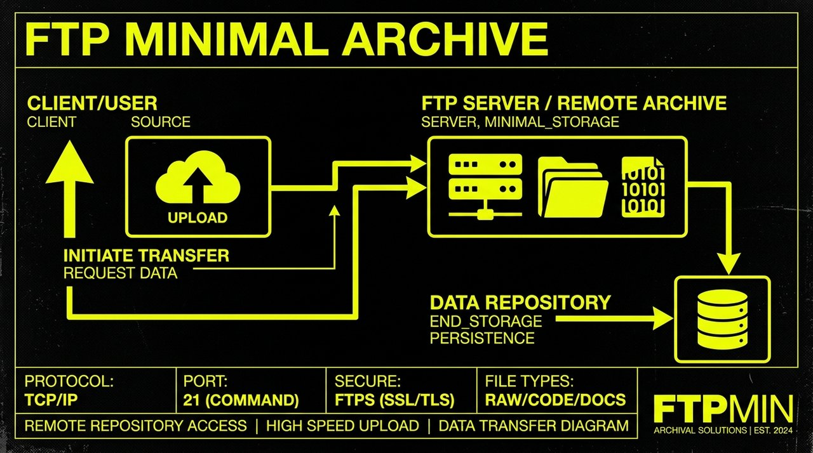

# FTP Minimal Archive // Static File Explorer & Indexer

  

> **Minimalist static archive browser and lightweight FTP deployment organizer for client assets, release bundles, and static packages.**

---

## Overview

**FTP Minimal Archive** is an ultra-lightweight, zero-database file archive and directory browser. Designed specifically for shared hosting, FTP servers, and static delivery nodes, it transforms any directory into a clean, modern, and accessible file browser without requiring MySQL, heavy frameworks, or backend complexity.

---

## Features

- **Single-File Simplicity**: Drop `index.php` into any folder and it instantly renders an indexed directory list.
- **Zero Database Requirement**: Direct filesystem scanning with sub-millisecond execution.
- **Privacy & Security**: Automatically ignores `.git`, `.htaccess`, and configuration files.
- **Swiss Minimalist UI**: High-contrast dark theme, crisp typography, and mobile-friendly tap targets.
- **Direct Download Routing**: Automatic filesize calculation and clean download triggers.

---

## Deployment

1. Upload `index.php` to your target directory on any FTP or shared host.
2. Ensure file permissions permit reading the parent directory.
3. Place files or release `.zip` archives into the same folder.
4. Navigate to `https://yourdomain.com/archive/` to view your files.

---

## Design Principles

- **No Overengineering**: Single-file PHP script with embedded CSS.
- **No Third-Party CDNs**: Completely self-contained; works in air-gapped or restricted environments.
- **Instant Speed**: Zero network latency after connection.

---

## License & Attribution

Engineered by **Emanuele BDC (EmaF205)**.  
Released under the [MIT License](LICENSE).
